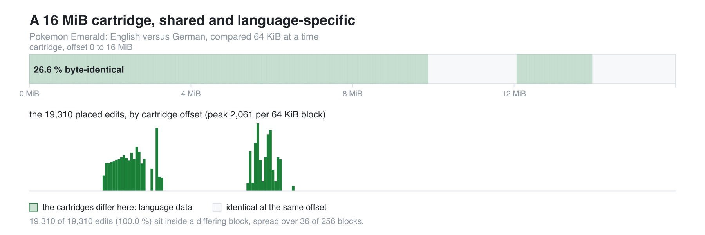

# romcarve

Find a language's text inside a retail cartridge and pin it into a decompilation
port, without having a decompilation tree for that language.

Pokemon Emerald shipped in five languages. English has a decompilation that
reproduces the retail ROM; French has a fork that does, and Italian and Spanish have
trees that carry their text; **German has no decompilation of any kind**. A language
still gets into a port through a manifest of `(source span, cartridge offset)` rows
- so every piece of text, every table and every credit entry has to be *located in
the cartridge* first. This repository is the tooling that did that for German
(`BPED`, `Smaragd-Edition`) with no encoder tree to lean on, plus the audits that
keep the result honest.

It is not a framework: these are the tools as they were used, one per question,
and the method they implement. Everything here reads the cartridges and the
reference tree *you* point it at; no game image is distributed.

<picture>
  <source media="(prefers-color-scheme: dark)" srcset="docs/cartridge-map-dark.png">
  
</picture>

<sub>[vector version](docs/cartridge-map.svg) &#183; regenerate with `python3 docs/make_cartridge_map.py`</sub>

Two thirds of a cartridge is not shared with its sibling language. The band is the
whole 16 MiB image, compared 64 KiB at a time (26.6 % of blocks are identical;
byte for byte it is 27.4 %, the finer figure `check_cartridge.py` prints); the bars
are the 19 310 edits this project placed, at the same scale. **Every one of them
lands in a block that differs** - the cross-check that the placements describe the
real language data and nothing else.

## What came out of it

The German manifest, measured against the same 449 source files as the Italian
one it was derived from:

| | German | Italian (reference) | French |
|---|---|---|---|
| source files edited | 449 | 449 | 454 |
| text edits placed | 19 310 | 19 347 | 19 356 |
| graphics located | 104 | 104 | 99 |
| credits entries | 275 | 275 | 275 |
| Trainer Hill floor tables | 4 | 4 | 4 |
| source texts left unmapped | 17 | 1 | 10 |
| manifest size (gzip) | 224 KiB | 225 KiB | 226 KiB |

The 37 edit gap between German and Italian is not noise: those are the entries no
anchor could place, listed in the manifest as unmapped rather than guessed.

Edits by kind, German: `c` 9 078, `asm` 7 945, `u16s` 1 186, `u32` 1 008,
`u16array` 72, `bard` 19, plus three single-row tables.

The same tool chain produced the **18 837 of 19 347 (97.36 %)** placement rate the
mapping reached before the last manual pass, each tool validated against the
Italian mapping as an *oracle* before it was trusted on German.

## Requirements

`python3` and `numpy` for the vectorised matcher (`tools/ref/matcher2.py`); the
rest is standard library. The container recipes under `build/` assume the
devkitARM image, and `LOC_*` environment variables tell every tool where your
workspace, cartridges and reference tree are.

## Try it

The first step needs no manifest at all - identify your cartridge, then measure
how much of it is shared with one you already mapped:

```console
$ python3 tools/check_cartridge.py emerald.gba
file        emerald.gba
size        16777216 bytes (16.00 MiB)
header      title 'POKEMON EMER'  code 'BPED'  revision 0
md5         f793a854654b467211fc32c4062cb183
sha1        61c2eb2b380b1a75f0c94b767a2d4c26cd7ce4e3
verdict     German release, byte-identical to the dump this project measured its offsets against

$ python3 tools/check_cartridge.py emerald_en.gba --compare smaragd.gba
...
identical at the same offset : 4595712 / 16777216 bytes (27.4 %)
differs                      : 12181504 bytes
differing regions >= 16 KiB  : 6
   0x00000000 .. 0x00652000  (6472.0 KiB)
   0x00674000 .. 0x009D3000  (3452.0 KiB)
   ...
```

Two thirds of a cartridge is *not* shared with its sibling language. Those regions
are the language data, and that is what the carver walks.

## The pilot

The 86 tools share a workspace and an order. `romcarve.py` is the entry point that
knows both: it reads a per-game profile, prints the questions in the order they have
to be asked with the tool that answers each and **what stays a human decision**,
tracks which artefacts exist, runs a stage with your arguments and logs it, and
summarises what a manifest claims.

```console
$ python3 romcarve.py languages
Pokemon Emerald - base decompilation pret/pokeemerald
code  language    sha1                                      reference manifest  cartridge
BPED  DE          61c2eb2b380b1a75f0c94b767a2d4c26cd7ce4e3  german.json.gz      found
BPEE  EN          f3ae088181bf583e55daf962a92bb46f4f1d07b7  -                   found
...

$ python3 romcarve.py plan audit
 1. audit     which entries are false?
    tool     tools/audit/dup_audit.py
    artefact dup_report.json
    human    read what the audits cannot see: files shifted by exactly one record

$ python3 romcarve.py run ref -- DE      # executes the stage's tool, logs it
$ python3 romcarve.py report work/german.json.gz
files      449
edits      19310
    c           9078
    asm         7945
    u16s        1186
...
```

`docs/adding-a-language.md` is the honest version of "can we do another language":
the two-minute structural test, what a language needs, what a new game needs beyond
a profile, and the parts that never stop being manual.

## The method, in ten stages

Each stage answers one question and writes a JSON artefact the next stage reads.
The tools live in `tools/<stage>/`, named after the question they answer.

| stage | question | tools |
|---|---|---|
| `ref` | where is this edit on the *reference* side, and where does the target ROM stop matching byte for byte? | `en_nm`, `enlayout`, `enlocate`, `matcher`/`matcher2`, `zones`, `structmap`, `shiftmap`, `conv_romoffset` |
| `carve` | with no manifest for the target language, where are its text objects? | `carve7`, `analyze_carve`, `drop_head`, `diag_file`, `diag_regions`, `diag5`, `diagcorr`, `probe_why` |
| `align` | which target objects line up with which reference objects, and what is the offset rule between them? | `anchors_sec`, `anchors_de`, `dechain`, `chain`, `chain_walk`, `content_find`, `align_file`, `objalign`, `hybrid`, `dewake3`, `secalign`, `sde` |
| `tables` | where do fixed-stride tables, struct-of-strings tables and the easy-chat chains live? | `form12`, `form3`, `struct_table`, `struct_scan`, `struct_scan2`, `fixed_stride2`, `ec_chain`, `ec_table`, `ec_words`, `u32_table`, `probe_u32` |
| `place` | where does a *pool* of strings start, when only its neighbours are known? | `deplace2`, `deplace3`, `poolfit`, `pool_find`, `pool_walk`, `batch_pool`, `union_walk5`, `place_interval`, `place_chunk`, `place_all`, `place_content`, `gap_fill`, `run_find`, `bracket`, `walk_anchor`, `walk_oracle` |
| `merge` | how does a placement become an entry in the mapping, and what is refused? | `merge_de`, `merge_c7k`, `merge_ec`, `merge_pool`, `merge_struct`, `merge_gap`, `merge_tail`, `merge_u32`, `merge_chunk`, `merge_shifts` |
| `audit` | which entries are false? | `ratio_audit`, `dup_audit`, `delta_audit`, `de_gate`, `verify_de`, `verify_added`, `verify_all`, `langcheck_de`, `dup_fix`, `fix_prefix`, `revert_bad` |
| `graphics` | where do the graphic assets live, and is the source text really the cartridge's text? | `de_graphics_locate`, `degerman` |
| `manifest` | assemble, self-check and export the manifest | `build_de_manifest`, `de_manifest_verify`, `emit_symbols` |
| `view` | read one file, one edit at a time, to adjudicate a doubtful entry by hand | `show_file`, `show_align`, `head_show` |

`docs/method.md` explains the invariants, the defect classes the audits exist to
catch, and the numbers behind each lever. `docs/manifest-format.md` documents the
manifest schema a port has to consume. `docs/three-routes.md` names the three ways a
language gets into a port - with a language tree, with a cartridge only, or from a
translated ROM - and says which one each of the port's five languages took.

## What the output looks like

```json
{
  "version": "0.1-de",
  "rom_sha1": "61c2eb2b380b1a75f0c94b767a2d4c26cd7ce4e3",
  "status": "experimental",
  "files": {
    "data/event_scripts.s": {
      "sha256": "9663b32f...",
      "edits": [[37060, 37135, 2613908, 59, "asm"], ...]
    }
  },
  "graphics": [["graphics/credits/the_end_copyright.4bpp.lz", 14565512, 519]],
  "credits": 6257408,
  "credits_entries": 275,
  "floors": [["sFloors_Normal", 6518944, 3808]],
  "unmapped_source_texts": 17,
  "checks": {}
}
```

One edit is `[source_start, source_end, rom_offset, size, kind]`: the span in the
decompiled source, the offset in the retail cartridge, its byte size, and the
shape of the data. The `sha256` pins the source file the span was measured
against, so the manifest refuses to be applied to a drifted tree.

## Where the method stops

- **37 entries could not be placed** in German and are shipped as unmapped. They
  are structural tables with no surviving anchor; guessing them would have been
  worse than listing them.
- **A German reference symbol table cannot be built from the port's tree.** It
  needs a GBA link of the game, and the port's tree overflows GBA IWRAM by 2.6x,
  its makefile dropped two variables its own data rules still call, and the pinned
  upstream carries no `tools/agbcc` (it is installed from `pret/agbcc`, see
  `build/container_de_validate.sh`). The recipe and the exact
  `nm -S --defined-only` format are in `docs/method.md`.
- **The pilot drives the tools, it does not replace the reading.** It knows the
  order and the artefacts, and it says on every stage what a human still has to do
  there. A new game is a profile plus whatever table descriptors it needs; a new
  language needs one already mapped, to serve as the oracle.
- Tool docstrings and comments are in French, the working language of the
  project. The method documentation here is in English.

## Provenance

The port ships five languages, and they share one pipeline: a checked-in manifest of
source spans and ROM offsets, staged from the reader's own cartridge at bootstrap
time and carrying no game text. What differs between languages is the **encoder
side** - the tree the text is re-encoded from when a manifest is self-checked.

| language | encoder side | offsets measured in | landed as |
|---|---|---|---|
| English | the decompilation itself | - | the port's base |
| French | [`malahx/pokeemerald`](https://github.com/malahx/pokeemerald/tree/french_enhanced), branch `french_enhanced`, at the commit whose `rom.sha1` is BPEF | BPEF | [port #34](https://github.com/ZallaxDev/pokeemerald-3Ds-dualscreen/pull/34) (andyst-dev), completed in [#43](https://github.com/ZallaxDev/pokeemerald-3Ds-dualscreen/pull/43) (Sneazynek), metric units in [#62](https://github.com/ZallaxDev/pokeemerald-3Ds-dualscreen/pull/62) |
| Italian | an Italian tree in a multi-language branch (`data/text/italian/`, `#elif ITALIAN` arms) | BPEI | [port #63](https://github.com/ZallaxDev/pokeemerald-3Ds-dualscreen/pull/63) (andyst-dev), re-pinned in [#88](https://github.com/ZallaxDev/pokeemerald-3Ds-dualscreen/pull/88) (yesyes-source) |
| Spanish | the port's Spanish tree | BPES | [port #52](https://github.com/ZallaxDev/pokeemerald-3Ds-dualscreen/pull/52) (Deunnis) |
| German | **none exists.** The only German source text is 2 137 literals in [`AsparagusEduardo/pokeemerald`](https://github.com/AsparagusEduardo/pokeemerald) branch `pret_europe_german`; the rest had to be located with no encoder at all | BPED | [port #96](https://github.com/ZallaxDev/pokeemerald-3Ds-dualscreen/pull/96) (andyst-dev), from [issue #28](https://github.com/ZallaxDev/pokeemerald-3Ds-dualscreen/issues/28) |

Note that `pret/pokeemerald` is English only, and `pret_europe` is a branch of
`AsparagusEduardo/pokeemerald`, not of `pret/`.

The Italian, French and Spanish manifests ship inside the port under
`tools/locales/`; they are this toolkit's **inputs**, and the oracle every tool here
was scored on. German is the case this repository exists for: with no encoder tree,
both sides of every edit had to be established from the cartridge alone, which is
what the carver, the anchors and the audits do. A separate fix for the port's own
test harness, found while building the German variant, is
[#97](https://github.com/ZallaxDev/pokeemerald-3Ds-dualscreen/pull/97), and
[#75](https://github.com/ZallaxDev/pokeemerald-3Ds-dualscreen/pull/75) is what keeps
a translated ROM's name and name-prefix order correct.

## Credits

- [`pret/pokeemerald`](https://github.com/pret/pokeemerald) - the English
  decompilation the spans are expressed in, and the base every language derives
  from.
- [`AsparagusEduardo/pokeemerald`](https://github.com/AsparagusEduardo/pokeemerald)
  branch `pret_europe_german` - the multi-language source that carries 2 137
  German literals. All 2 137 were found in the retail cartridge, which is what
  made those edits need no alignment at all.
- [`ZallaxDev/pokeemerald-3Ds-dualscreen`](https://github.com/ZallaxDev/pokeemerald-3Ds-dualscreen)
  - the port this manifest was built for, and the source of the Italian mapping
  used as the oracle and the reference.
- The Italian and French mappings, whose languages were mapped before German and
  whose published manifests serve as the standard each tool is measured against.

## Licence

MIT. No game image, decompilation tree or extracted game text is distributed
here.
