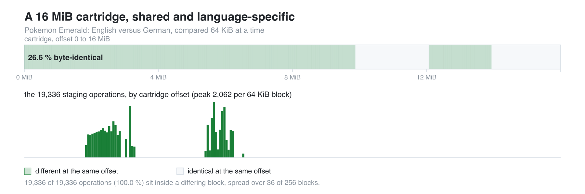

# romcarve

Find a language's text inside a retail cartridge and pin it into a decompilation
port, without having a decompilation tree for that language.

Pokemon Emerald shipped in five languages. English has a decompilation that
reproduces the retail ROM; French has a fork that does, and Italian and Spanish have
trees that carry their text. **No complete German retail-matching encoder tree was
available to this work.** A language still gets into a port through a manifest of `(source span, cartridge offset)` rows
- so every piece of text, every table and every credit entry has to be *located in
the cartridge* first. This repository is the tooling that did that for German
(`BPED`, `Smaragd-Edition`) with no encoder tree to lean on, plus the audits that
keep the result honest.

It is not a framework: these are the tools as they were used, one per question,
and the method they implement. Everything here reads the cartridges and the
reference tree *you* point it at; no game image is distributed.

<picture>
  <source media="(prefers-color-scheme: dark)" srcset="docs/cartridge-map-final-dark.png">
  
</picture>

<sub>[vector version](docs/cartridge-map-final.svg) &#183; regenerate with `python3 docs/make_cartridge_map.py`</sub>

The band is the whole 16 MiB image, compared 64 KiB at a time: 26.6 % of
blocks are identical. Byte for byte it is 27.4 %, the finer figure printed by
`check_cartridge.py`. The bars show the **19 336 final staging operations**, spread
across 36 blocks. Every operation starts in a differing block. Differences also
include pointers and relocated data, not only translated text.

## What came out of it

The German integration is finalized and published in
[port #96](https://github.com/ZallaxDev/emerald-3ds/pull/96), at tested revision
`d45dc3b7c49f4b2ab8926efb25168095fab165a7`, based on public `dev` `0087891`.
The PR is open for maintainer review, not described as merged.

| | German | Italian (reference) | French |
|---|---|---|---|
| source files edited | 449 | 449 | 454 |
| staging operations | 19 336 | 19 347 | 19 356 |
| graphics located | 105 | 104 | 101 |
| credits entries | 275 | 275 | 275 |
| Trainer Hill floor tables | 4 | 4 | 4 |
| source texts left unmapped | 0 | 1 | 10 |
| manifest size (gzip, KiB) | 225.9 | 224.0 | 225.0 |

All **37 original gaps have explicit decisions**: 28 verified retail placements,
eight keyboard rows supplied by the complete retail table, and one unused empty
initializer deliberately retained. They are not 37 forced one-to-one placements.
The keyboard has nine columns, all six umlauts work, and the battle HUD uses the
retail **KP** asset rather than a hand-drawn replacement.

The partial BPED reference table has **15 087 evidenced nonzero addresses among
48 858 names**; unproven names remain at zero. The production builder reconstructs
all **6 396 pack entries byte-for-byte on macOS and Linux**. All three
[upstream CI jobs pass](https://github.com/ZallaxDev/emerald-3ds/actions/runs/39972088637).
These are results of the port integration, not a claim that the research scripts
recreate the complete process unattended.

See the [completion record](docs/german-completion.md) and its
[machine-readable facts](docs/german-validation.json) for the tested commit,
recipe budget, symbol limits and human-test boundary. No game data is included.

Counts are operations, not distinct sentences or a universal coverage percentage.
The initial automatic pass reached 18 837 of 19 347 candidate placements before
manual repairs; that historical figure is not the final manifest size.

## Requirements

`python3` and `numpy` for the vectorised matcher (`tools/ref/matcher2.py`); the
rest is standard library. The container recipes under `build/` assume the
devkitARM image, and `LOC_*` environment variables tell every tool where your
workspace, cartridges and reference tree are.

## Try it

The first step needs no manifest at all - identify your cartridge, then measure
how much of it is shared with one you already mapped:

```console
$ python3 tools/check_cartridge.py emerald.gba
file        emerald.gba
size        16777216 bytes (16.00 MiB)
header      title 'POKEMON EMER'  code 'BPED'  revision 0
md5         f793a854654b467211fc32c4062cb183
sha1        61c2eb2b380b1a75f0c94b767a2d4c26cd7ce4e3
verdict     German release, byte-identical to the dump this project measured its offsets against

$ python3 tools/check_cartridge.py emerald_en.gba --compare smaragd.gba
...
identical at the same offset : 4595712 / 16777216 bytes (27.4 %)
differs                      : 12181504 bytes
differing regions >= 16 KiB  : 6
   0x00000000 .. 0x00652000  (6472.0 KiB)
   0x00674000 .. 0x009D3000  (3452.0 KiB)
   ...
```

Two thirds of a cartridge is *not* shared with its sibling language. Those regions
are the language data, and that is what the carver walks.

## The pilot

The research tools share a workspace and an order. `romcarve.py` is the entry point that
knows both: it reads a per-game profile, prints the questions in the order they have
to be asked with the tool that answers each and **what stays a human decision**,
tracks which artefacts exist, runs a stage with your arguments and logs it, and
summarises what a manifest claims.

```console
$ python3 romcarve.py languages
Pokemon Emerald - base decompilation pret/pokeemerald
code  language    sha1                                      reference manifest  cartridge
BPED  DE          61c2eb2b380b1a75f0c94b767a2d4c26cd7ce4e3  german.json.gz      found
BPEE  EN          f3ae088181bf583e55daf962a92bb46f4f1d07b7  -                   found
...

$ python3 romcarve.py plan audit
 1. audit     which entries are false?
    tool     tools/audit/dup_audit.py
    artefact dup_report.json
    human    read what the audits cannot see: files shifted by exactly one record

$ python3 romcarve.py run ref -- DE      # executes the stage's tool, logs it
$ python3 romcarve.py report work/german.json.gz --symbols work/german-symbols.s.gz
files      449
edits      19336
    c           9102
    asm         7945
    u16s        1186
...
unmapped   0 source texts
decisions  37
...
id_lists   4
symbols    48858 names, 15087 nonzero, 33771 unresolved
           metadata only; cartridge addresses are not validated
```

`docs/adding-a-language.md` is the honest version of "can we do another language":
the two-minute structural test, what a language needs, what a new game needs beyond
a profile, and the parts that never stop being manual.

## The method, in ten stages

Each stage answers one question and writes a JSON artefact the next stage reads.
The tools live in `tools/<stage>/`, named after the question they answer. The pilot
adds one more question before them - `check`, the cartridge identity - for eleven in
total.

| stage | question | tools |
|---|---|---|
| `ref` | where is this edit on the *reference* side, and where does the target ROM stop matching byte for byte? | `en_nm`, `enlayout`, `enlocate`, `matcher`/`matcher2`, `zones`, `structmap`, `shiftmap`, `conv_romoffset` |
| `carve` | with no manifest for the target language, where are its text objects? | `carve7`, `analyze_carve`, `drop_head`, `diag_file`, `diag_regions`, `diag5`, `diagcorr`, `probe_why` |
| `align` | which target objects line up with which reference objects, and what is the offset rule between them? | `anchors_sec`, `anchors_de`, `dechain`, `chain`, `chain_walk`, `content_find`, `align_file`, `objalign`, `hybrid`, `dewake3`, `secalign`, `sde` |
| `tables` | where do fixed-stride tables, struct-of-strings tables and the easy-chat chains live? | `form12`, `form3`, `struct_table`, `struct_scan`, `struct_scan2`, `fixed_stride2`, `ec_chain`, `ec_table`, `ec_words`, `u32_table`, `probe_u32` |
| `place` | where does a *pool* of strings start, when only its neighbours are known? | `deplace2`, `deplace3`, `poolfit`, `pool_find`, `pool_walk`, `batch_pool`, `union_walk5`, `place_interval`, `place_chunk`, `place_all`, `place_content`, `gap_fill`, `run_find`, `bracket`, `walk_anchor`, `walk_oracle` |
| `merge` | how does a placement become an entry in the mapping, and what is refused? | `merge_de`, `merge_c7k`, `merge_ec`, `merge_pool`, `merge_struct`, `merge_gap`, `merge_tail`, `merge_u32`, `merge_chunk`, `merge_shifts` |
| `audit` | which entries are false? | `ratio_audit`, `dup_audit`, `delta_audit`, `de_gate`, `verify_de`, `verify_added`, `verify_all`, `langcheck_de`, `dup_fix`, `fix_prefix`, `revert_bad` |
| `graphics` | where do the graphic assets live, and is the source text really the cartridge's text? | `de_graphics_locate`, `degerman` |
| `manifest` | assemble, self-check and export the manifest | `build_de_manifest`, `de_manifest_verify`, `emit_symbols` |
| `view` | read one file, one edit at a time, to adjudicate a doubtful entry by hand | `show_file`, `show_align`, `head_show` |

`docs/method.md` explains the invariants, the defect classes the audits exist to
catch, and the numbers behind each lever. `docs/manifest-format.md` documents the
manifest schema a port has to consume. `docs/three-routes.md` names the three ways a
language gets into a port - with a language tree, with a cartridge only, or from a
translated ROM - and says which one each of the port's five languages took.

## What the output looks like

```json
{
  "version": "0.1-de",
  "rom_sha1": "61c2eb2b380b1a75f0c94b767a2d4c26cd7ce4e3",
  "status": "experimental",
  "files": {
    "data/event_scripts.s": {
      "sha256": "9663b32f...",
      "edits": [[37060, 37135, 2613908, 59, "asm"], ...]
    }
  },
  "graphics": [["graphics/credits/the_end_copyright.4bpp.lz", 14565512, 519]],
  "credits": 6257408,
  "credits_entries": 275,
  "floors": [["sFloors_Normal", 6518944, 3808]],
  "unmapped_source_texts": [],
  "checks": {}
}
```

One edit is `[source_start, source_end, rom_offset, size, kind]`: the span in the
decompiled source, the offset in the retail cartridge, its byte size, and the
shape of the data. The `sha256` pins the source file the span was measured
against, so the manifest refuses to be applied to a drifted tree.

## Where the method stops

- **Zero unresolved source editions is not an exhaustive playthrough.** Every
  original gap has a reviewed decision, including table adaptations and a
  no-change case. See the completion record for the actual play checks.
- **The reference is partial, not a German retail ELF.** Its nonzero addresses
  were established against BPED; unknowns remain zero. A 3DS ELF's addresses or
  an arbitrary GBA link are not retail addresses. A recipe that merely generates
  is not proof: the production reconstruction must match every file and generator
  output. `report --symbols` checks metadata shape and counts, not cartridge truth.
- **The pilot drives the research tools, not the human decisions.** Tools share a
  prepared workspace and an oracle language. The final port integrations and
  validation live in the linked port revision; they are not all automated here.
- Existing research-tool comments are in French. The CLI output, new tests and
  public method documentation are in English.

## Provenance

The five retail-cartridge variants share one pipeline: a checked-in manifest of
source spans and ROM offsets, staged from the reader's own cartridge at bootstrap
time and carrying no game text. What differs between languages is the **encoder
side** - the tree the text is re-encoded from when a manifest is self-checked.

| language | encoder side | offsets measured in | landed as |
|---|---|---|---|
| English | the decompilation itself | - | the port's base |
| French | [`malahx/pokeemerald`](https://github.com/malahx/pokeemerald/tree/french_enhanced), branch `french_enhanced`, at the commit whose `rom.sha1` is BPEF | BPEF | [port #34](https://github.com/ZallaxDev/emerald-3ds/pull/34) (andyst-dev) **closed**, landed through [#43](https://github.com/ZallaxDev/emerald-3ds/pull/43) (Sneazynek); metric units in [#62](https://github.com/ZallaxDev/emerald-3ds/pull/62) (andyst-dev) |
| Italian | an Italian tree in a multi-language branch (`data/text/italian/`, `#elif ITALIAN` arms) | BPEI | [port #63](https://github.com/ZallaxDev/emerald-3ds/pull/63) (andyst-dev), re-pinned in [#88](https://github.com/ZallaxDev/emerald-3ds/pull/88) (yesyes-source) |
| Spanish | the port's Spanish tree | BPES | [port #52](https://github.com/ZallaxDev/emerald-3ds/pull/52) (Deunnis) |
| German | **No complete retail-matching encoder tree was used.** There are 2 137 anchor literals in [`AsparagusEduardo/pokeemerald`](https://github.com/AsparagusEduardo/pokeemerald) branch `pret_europe_german`; the rest had to be located with no encoder at all | BPED | [port #96](https://github.com/ZallaxDev/emerald-3ds/pull/96) (andyst-dev, open), from [issue #28](https://github.com/ZallaxDev/emerald-3ds/issues/28) |

### Authorship

The French, Italian and German manifest/staging integrations were authored by
[**andyst-dev**](https://github.com/andyst-dev), on the rails the Spanish variant set:

- **French** - [#34](https://github.com/ZallaxDev/emerald-3ds/pull/34):
  the manifest over the source files (448 at the time, 454 today),
  `tools/localize_french.py` and its SHA-1/SHA-256 checks, the BPEF builder profile
  and web payload, `--french-rom` in the bootstrap and release scripts, the ending
  tilemap, berry names and Pokédex-unit patches, and `docs/FRENCH.md`. Closed once
  Sneazynek's follow-up [#43](https://github.com/ZallaxDev/emerald-3ds/pull/43)
  landed it (port menus, accents, locale tables); native metric units followed in
  [#62](https://github.com/ZallaxDev/emerald-3ds/pull/62).
- **Italian** - [#63](https://github.com/ZallaxDev/emerald-3ds/pull/63),
  merged: 449 source files, 19 347 edits, 104 graphics, 275 credits entries, the four
  Trainer Hill floors, the Italian glyphs, the fourth `CTR_TEXT` column and the
  Italian ending tilemap, plus the layout patch (metric Pokédex units with a decimal
  comma, the wider type table, glued berry names). Re-pinned later in
  [#88](https://github.com/ZallaxDev/emerald-3ds/pull/88).
- **German** - [#96](https://github.com/ZallaxDev/emerald-3ds/pull/96),
  open, finalized and CI-green: 449 source files, 19 336 operations, 105 graphics,
  275 credits entries, the four floors, with **no encoder tree** - built with the tooling in this repository, from
  [issue #28](https://github.com/ZallaxDev/emerald-3ds/issues/28).

The Spanish variant is Deunnis's ([#52](https://github.com/ZallaxDev/emerald-3ds/pull/52)),
and [#75](https://github.com/ZallaxDev/emerald-3ds/pull/75) is what keeps
a translated ROM's name and name-prefix order correct.

Note that `pret/pokeemerald` is English only, and `pret_europe` is a branch of
`AsparagusEduardo/pokeemerald`, not of `pret/`.

The Italian, French and Spanish manifests ship inside the port under
`tools/locales/`; they are this toolkit's **inputs**, and the oracle every tool here
was scored on. German is the case this repository exists for: with no encoder tree,
both sides of every edit had to be established from the cartridge alone, which is
what the carver, the anchors and the audits do. A separate fix for the port's own
test harness, found while building the German variant, was proposed in
[#97](https://github.com/ZallaxDev/emerald-3ds/pull/97), now closed
as redundant with the already-merged [#92](https://github.com/ZallaxDev/emerald-3ds/pull/92). Also,
[#75](https://github.com/ZallaxDev/emerald-3ds/pull/75) is what keeps
a translated ROM's name and name-prefix order correct.

## Credits

- [`pret/pokeemerald`](https://github.com/pret/pokeemerald) - the English
  decompilation the spans are expressed in, and the base every language derives
  from.
- [`AsparagusEduardo/pokeemerald`](https://github.com/AsparagusEduardo/pokeemerald)
  branch `pret_europe_german` - the multi-language source that carries 2 137
  German literals. All 2 137 were found in the retail cartridge, which is what
  made those edits need no alignment at all.
- [`ZallaxDev/emerald-3ds`](https://github.com/ZallaxDev/emerald-3ds)
  - the port this manifest was built for, and the source of the Italian mapping
  used as the oracle and the reference.
- The Italian and French mappings, whose languages were mapped before German and
  whose published manifests serve as the standard each tool is measured against.

## Licence

MIT. No game image, decompilation tree or extracted game text is distributed
here.
